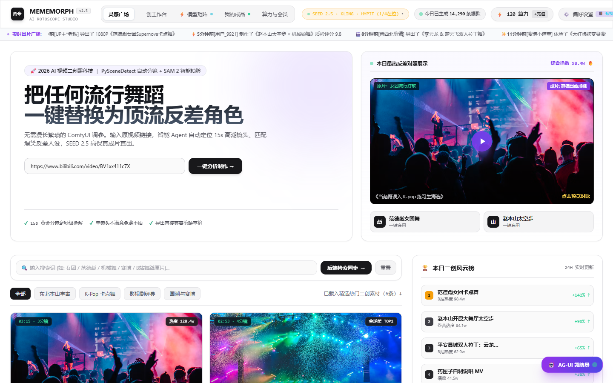
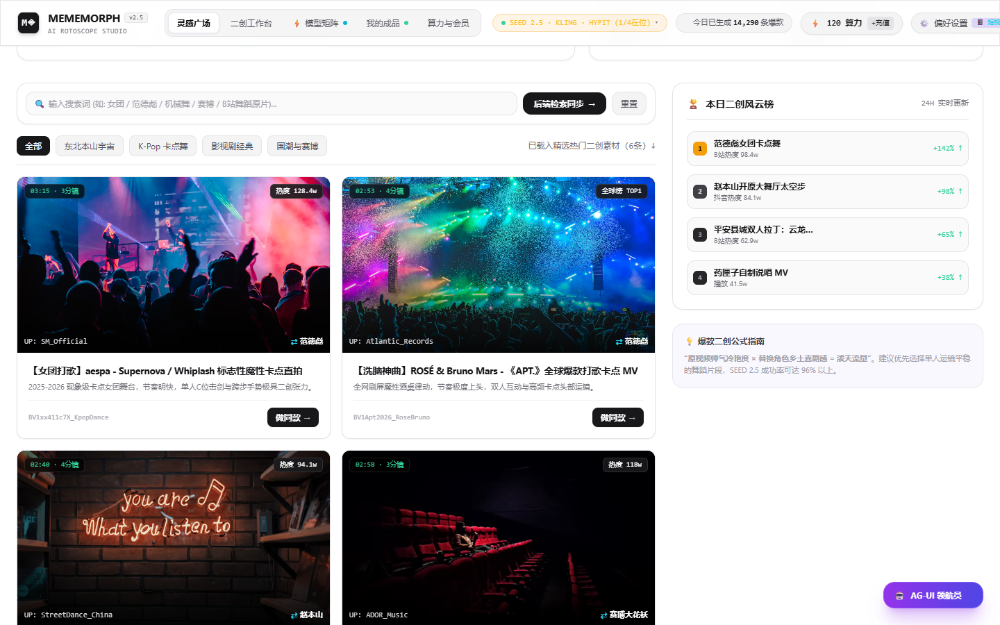
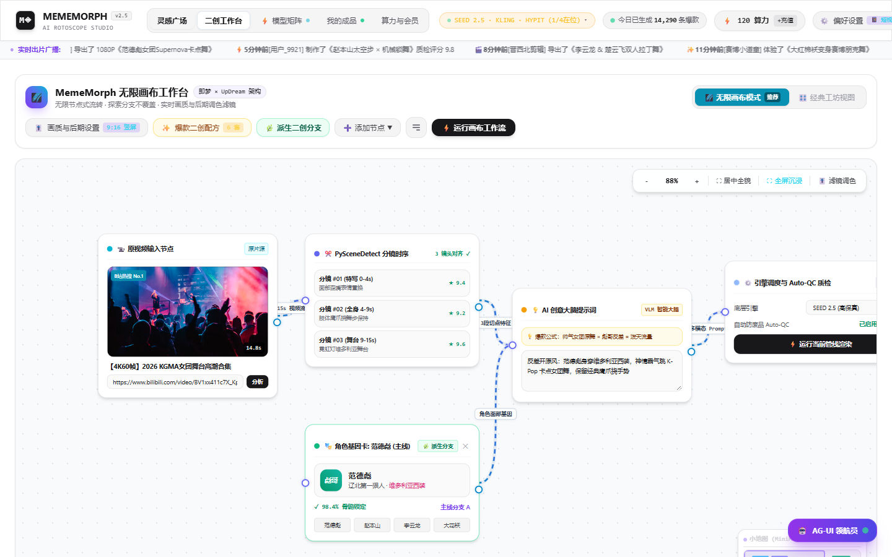
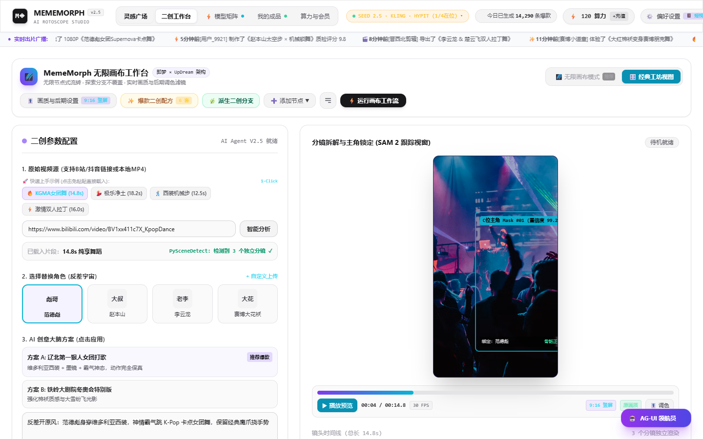
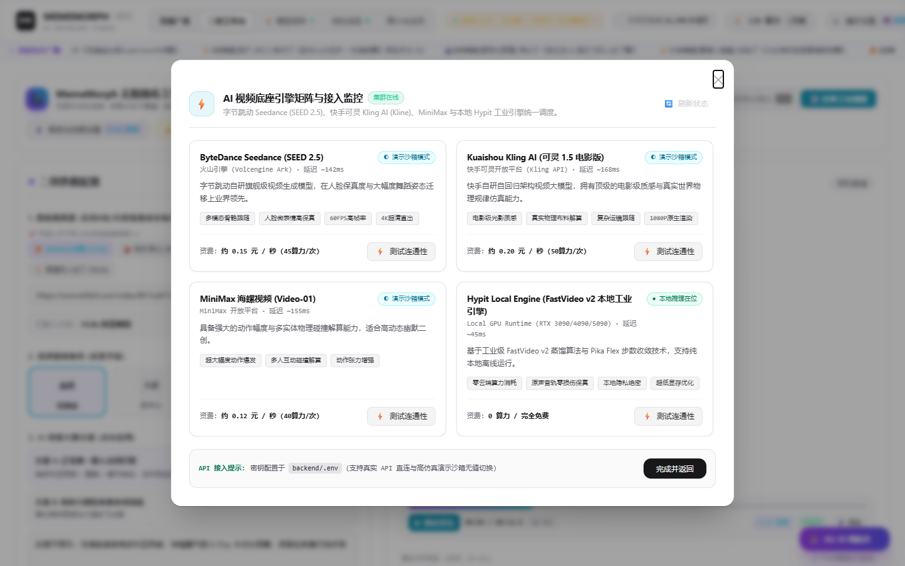
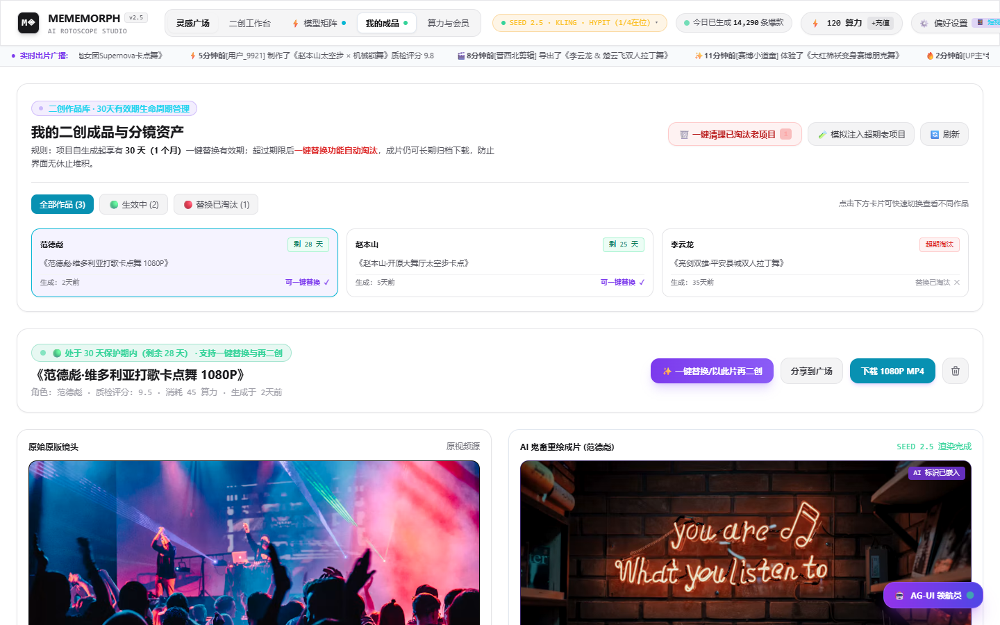
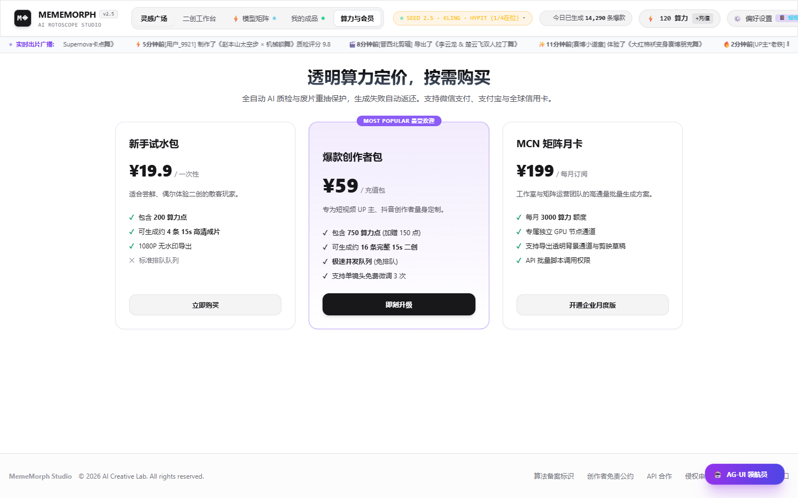

# MemeMorph 梗影AI (Meme-Rotoscope-Studio)

<div align="center">

[](LICENSE)
[](https://www.python.org/)
[](https://fastapi.tiangolo.com/)
[](https://github.com/ag-ui-protocol/ag-ui)
[](https://github.com/)

**MemeMorph 是一款可以即时搜索 B 站等新媒体平台的智能创意工具，允许客户使用 Hypit 技能进行编辑的同时也支持一键长视频修改。**  
*基于字节跳动 SEED 2.5 / 快手可灵 1.5 / MiniMax 海螺 / 本地工业级 Hypit FastVideo v2*  
*Meta SAM 2 智能目标追踪 + PySceneDetect 镜头切分 + AG-UI 协议全双工协同 + Agent Reach 新媒体实时直通*

[🖥️ C 端前台原型 (prototype.html)](prototype.html) • [🛡️ 运营中台 (admin.html)](admin.html) • [⚡ 一键启动脚本 (start_ui.bat)](start_ui.bat) • [📊 定价精算表 (.xlsx)](MemeMorph_算力与会员定价全景精算表.xlsx) • [💬 联系作者](#-作者简介与微信交流群-author--contact)

</div>

---

## 📸 视觉全景与多视窗展示 (Visual Showcase)

本项目前端已全量重构为现代 **Apple / Vercel Light Studio 纯白极简设计规范**，搭配超高可读性炭黑文字、微弥散投影与专业级高对比影院监视器：

| 视图 | 预览图 | 核心亮点 |
| :--- | :--- | :--- |
| **Hero 探索大厅** |  | 非对称 Bento 布局、全网实时出片广播跑马灯、一键分析入口、一键长视频模式切换 |
| **B站/抖音热门信息流** |  | Agent Reach 驱动实时检索 B站 & 抖音爆款 MV、分类过滤胶囊、二创人设智能推荐 |
| **二创无限画布** |  | UpDream 风格自由节点拓扑、保留分支探索不覆盖、流光贝塞尔连线 |
| **经典双栏工作台** |  | 影院级高对比黑底监视器、参数精调底座、一键长视频修改开关、角色基因芯片 |
| **四维模型底座矩阵** |  | 字节 SEED 2.5、可灵 1.5、MiniMax、本地 Hypit 引擎状态探测 |
| **成品交付与生命周期** |  | Split Wipe 划动成片对比、分镜素材下载、30 天到期一键替换淘汰 |
| **算力与会员中心** |  | 纯白三栏定价方案卡片、算力透明扣点机制、企业算力池接入 |

---

## 📖 项目定位与核心价值 (Overview)

> **MemeMorph (梗影AI)** 是一款专注于短视频与长视频爆款二创、动作姿态迁移与工业级转绘的开源工具。平台集成了 **Agent Reach 新媒体实时直通能力**，允许用户即时搜索 B 站、抖音等新媒体平台的近期热门打歌舞与爆款 MV；创作者既可使用 **本地 Hypit 技能** 执行深度离线编辑与零算力出片，也可借助**一键长视频修改机制**完成完整 MV 的连续镜头切分与批量转绘缝合。

平台紧扣爆款传播法则：
$$\text{爆款指数} = \text{原视频流行/时尚/帅气度} \times \text{替换角色的乡土/喜感/反差打破第四面墙指数}$$

通过 **“新媒体全网热点即搜即用 + 15秒卡点/长视频滑动分块 + PySceneDetect 镜头切分 + SAM 2 伴舞背景高保真 + Auto-QC 质检重抽 + AG-UI 全双工人机协同”** 的端到端闭环，让普通创作者也能秒级生成具备专业光影质感的爆款二创视频。

---

## ⚡ 核心能力矩阵 (Key Capabilities)

### 1. Agent Reach 新媒体实时感知引擎 (B站 & 抖音热点直通)
* **双通道热点直连**：内置接入系统级 `agent-reach` CLI 工具，原生打通 B站 (`agent-reach bilibili hot/search`) 与抖音 (`agent-reach web search "抖音 热门舞蹈 MV"`)；
* **爆款二创人设自动推荐**：自动分析抓取到的视频标题与描述，智能匹配本山宇宙、范德彪、李云龙或赛博大花袄等经典反差人设，生成对应的二创 Prompt；
* **三级容灾高可用**：优先 Agent Reach 实时采录 $\to$ 次级 B站原生反爬虫会话 $\to$ 三级精选爆款素材池兜底，保障任何网络环境下前台信息流秒开不空白。

### 2. Hypit 技能深度编辑与一键长视频修改 (Long Video Continuous Rotoscope)
* **Hypit 工业级本地底座深度适配**：直接调度本地 Hypit 生产管道 (`fastvideo-flex` 6 步蒸馏加速 + `Pika Flex` 骨骼收敛技术)，实现 0 云端算力消耗、原声音轨无损保真与原片光影绝对锁定 (`lightingMode="source"`)；
* **一键长视频修改模式 (Long Video Mode)**：突破传统 AI 视频工具仅能生成 4~15 秒短视频的限制，通过 **PySceneDetect 全时序镜头切分 + 5s 动态滑动窗口分块规划 + Hypit swap-assemble 音频回流缝合**，实现 1~5 分钟完整长视频与 MV 的一键式端到端批量转绘；
* **时序无闪烁一致性**：引入跨分镜角色基因注入与首尾帧光流补偿，确保长视频在多机位镜头切换中角色面部与服饰特征始终稳定连贯。

### 3. 纯白极简工作台 (Modern Light Studio Aesthetic)
* **纯白优雅界面**：摒弃沉闷暗黑，采用纯白高透底色搭配炭黑高对比文字（`#09090b`）与石板灰中性层级（`#475569`）；
* **专业监视器黑底视窗**：视频对比视窗保留影院级黑底（`bg-black`），确保分镜色彩与边缘判定准确无干扰；
* **本地离线韧性**：Tailwind 运行时已本地化打包（`tailwind.min.js`），支持纯离线/内网环境零闪烁加载。

### 4. 即梦 & UpDream 风格节点式无限画布 (Infinite Node Canvas)
* **视界自由穿梭**：支持平移 (Pan)、鼠标滚轮平滑缩放 (35% ~ 200%)、空格拖拽与一键【⛶ 居中全貌】；
* **保留分支，探索不覆盖**：同一视频源支持一键【🌿 派生二创分支】，拉出多条分支（如分支 A 范德彪女团舞 vs 分支 B 赵本山机械锁舞），多角色多引擎并列演进直出对比，绝不覆盖历史节点；
* **SVG 流光贝塞尔导轨**：动态渐变光流连线，实时展现输入源 $\to$ 分镜切分 $\to$ 角色基因 $\to$ 提示词大脑 $\to$ 渲染底座 $\to$ 成品直出拓扑。

### 5. AG-UI 代理-用户交互协议与人机协同 (AG-UI Protocol & HITL)
* **SSE 全双工流式推送**：基于 Server-Sent Events 标准事件生命周期，彻底告别传统盲目轮询；
* **Auto-QC 质检与人机协同裁决 (HITL)**：当质检评分遇到形变临界值时，自动挂起并向前端推送裁决卡片，由创作者决策【通过并缝合】或【免费重抽此镜头】；
* **前端工具调用 (Frontend Tools)**：AI 创意领航员可通过自然语言指令自动调度前端画布派生分支、连线与缩放。
* **SSE 全双工流式推送**：基于 Server-Sent Events 标准事件生命周期，彻底告别轮询；
* **Auto-QC 质检与人机协同裁决 (HITL)**：当质检评分遇到形变临界值时，自动挂起并向前端推送裁决卡片，由创作者决策【通过并缝合】或【免费重抽此镜头】；
* **前端工具调用 (Frontend Tools)**：AI 创意领航员可通过自然语言指令自动调度前端画布派生分支、连线与缩放。

### 4. 四维大模型调度底座 (Multi-Engine Matrix)
* **ByteDance Seedance (SEED 2.5)**：字节跳动旗舰级视频生成模型，人脸保真度与大幅度舞蹈姿态迁移业界领先；
* **Kuaishou Kling AI (可灵 1.5 电影版)**：快手自研自回归架构，顶级电影级质感与真实世界物理规律仿真；
* **MiniMax 海螺视频 (Video-01)**：动作张力极高，适合高爆发街舞、跑酷与夸张喜剧动作；
* **本地工业级 Hypit 引擎 (FastVideo v2 / H3)**：纯本地 GPU (RTX 3090/4090/5090) 离线运行，0 云端算力消耗，原声音轨零损伤保真，原片光影绝对锁定 (`lightingMode="source"`)。

### 5. 30 天项目全生命周期与超期老项目淘汰机制
* **自动存续计算**：数据中心对作品自动计算剩余天数；
* **超期一键替换淘汰**：有效项目（< 30 天）可一键替换再二创；超期项目（≥ 30 天）自动置灰淘汰；
* **一键批量清理**：提供前台与中台一键释放功能，彻底解决历史老项目堆积与存储膨胀问题。

---

## 🛠️ API 接入与配置步骤 (API Integration Guide)

项目采用**自适应双模设计**：无需配置任何密钥即可使用内置的高保真智能 Mock 集群畅玩全流程；当需要接入真实大模型进行商用渲染时，只需在根目录配置 `.env` 即可一键点亮真机调用。

### 1. 环境变量配置模板 (`.env`)
复制项目根目录下的 `.env.example` 为 `.env`：
```bash
cp .env.example .env
```

---

### 2. 本地工业级 Hypit 引擎接入 (本地 GPU 0 算力私有化出片)
* **适用场景**：具备本地大显存 GPU (推荐 RTX 3090 / 4090 / 5090，显存 $\ge$ 22GB) 的创作者。
* **接入步骤**：
  1. 在本地部署原版 Hypit 生产工程（如 `D:/AI/gongzuoliu/clone video`）；
  2. 在 `.env` 中指定路径：
     ```ini
     HYPIT_HOME="D:/AI/gongzuoliu/clone video"
     ```
  3. 启动本地 Hypit ComfyUI 服务（默认 Comfy 端口 `8188`，H3 Comfy 端口 `8191`）；
  4. 后端服务启动时会自动探测 `Hypit.bat` 与 `local.models.json`，检测通过后前台【Hypit 本地工业引擎】状态徽标即刻点亮为“准备就绪 (Ready)”。

---

### 3. 字节跳动 Seedance (SEED 2.5 / 火山引擎方舟) 接入
* **适用场景**：高保真人脸微表情、大幅度卡点舞蹈姿态迁移。
* **接入步骤**：
  1. 访问 [火山引擎大模型方舟平台 (Volcengine Ark)](https://www.volcengine.com/product/ark)；
  2. 开通视频生成模型并创建在线推理接入点（Endpoint ID）；
  3. 在 `.env` 中填入火山引擎访问凭证：
     ```ini
     VOLCENGINE_ACCESS_KEY="your_volcengine_access_key"
     VOLCENGINE_SECRET_KEY="your_volcengine_secret_key"
     VOLCENGINE_ENDPOINT="https://ark.cn-beijing.volces.com/api/v3"
     VOLCENGINE_MODEL_ENDPOINT_ID="ep-2026xxxxxx-xxxx"
     ```
  4. 在前台模型矩阵弹窗中点击【测试连通性】，返回 200 即表示网关鉴权成功。

---

### 4. 快手可灵 Kling AI (可灵 1.5 电影版) 接入
* **适用场景**：电影级光影质感、复杂运镜跟随与布料物理仿真。
* **接入步骤**：
  1. 访问 [快手可灵开放平台 (Kling AI API)](https://api.klingai.com/) 注册开发者账号；
  2. 获取专属 `KLING_API_KEY`；
  3. 在 `.env` 中配置：
     ```ini
     KLING_API_KEY="your_kling_api_key_here"
     KLING_ENDPOINT="https://api.klingai.com/v1"
     ```

---

### 5. MiniMax 海螺视频 (Video-01) 接入
* **适用场景**：大幅度肢体爆发力、多人互动碰撞解算。
* **接入步骤**：
  1. 访问 [MiniMax 开放平台](https://api.minimax.chat/)；
  2. 获取 `API_KEY` 与 `GROUP_ID`；
  3. 在 `.env` 中配置：
     ```ini
     MINIMAX_API_KEY="your_minimax_api_key_here"
     MINIMAX_GROUP_ID="your_minimax_group_id_here"
     MINIMAX_ENDPOINT="https://api.minimax.chat/v1"
     ```

---

### 6. 视觉多模态 Auto-QC 与 Agent 质检模型接入
* **适用场景**：关键帧一致性评估、肢体畸变打分与人机协同裁决。
* **接入步骤**：
  支持 OpenAI、OneAPI、DeepSeek、Gemini 等任何兼容 OpenAI 格式的多模态端点：
  ```ini
  OPENAI_API_KEY="sk-xxxxxxxxxxxxxxxxxxxxxxxx"
  OPENAI_BASE_URL="https://api.openai.com/v1"
  ```

---

### 7. B站热门视频搜索与灵感广场爬虫
* **工作机制**：
  - 后端采用 `curl_cffi` 模拟真实浏览器握手，直连 B站 官方视频检索接口；
  - 自动识别视频标题提取舞蹈类型，智能推荐反差角色与创意提示词；
  - **网络防抖兜底**：当遇到网络限制或 IP 频控时，服务将自动无缝降级切换至内置精选二创爆款库（包含 aespa、ROSÉ & Bruno Mars《APT.》、周杰伦《霍元甲》等高质量模板），保证前台卡片永远完整呈现。

---

## 🚀 本地快速启动指南 (Quick Start)

### 1. 克隆代码仓库
```bash
git clone https://github.com/Jackeyhate9/meme-rotoscope-studio.git
cd meme-rotoscope-studio
```

### 2. 安装 Python 依赖
推荐使用 Python 3.10 或 3.11 环境：
```bash
# 创建并激活虚拟环境 (可选)
python -m venv venv
# Windows:
.\venv\Scripts\activate
# Linux/macOS:
source venv/bin/activate

# 安装核心依赖
pip install -r backend/requirements.txt
```

### 3. 一键启动 (Windows 极速体验)
直接双击运行根目录批处理脚本：
```powershell
.\start_ui.bat
```
脚本将自动在后台启动 FastAPI 服务（端口 8008），并自动拉起默认浏览器打开 C 端前台交互界面。

### 4. 命令行独立启动
```bash
# 启动 FastAPI 后端服务
python -m uvicorn app.main:app --app-dir backend --host 127.0.0.1 --port 8008 --reload
```
服务就绪后访问：
* **前台体验入口**：直接双击或静态托管打开 `prototype.html`
* **运营中台入口**：打开 `admin.html` (内置默认门禁: `Admin` / `123456`)
* **交互式 Swagger API 文档**：`http://127.0.0.1:8008/docs`

---

## 👤 作者简介与微信交流群 (Author & Contact)

<div align="center">

### 夏予 🎃
**📍 中国 · 北京 朝阳**  
*全栈架构师 • AI 短视频二创与姿态迁移算法研究员 • 开源创作者*

<br>


<br>

**扫描上方二维码添加作者个人微信（添加时请备注：`MemeMorph开源`）**

</div>

### 💡 深度交流与商业合作方向：
1. **开源共建与产品迭代**：UpDream 风格无限节点画布交互、AG-UI 协议全栈封装与落地。
2. **算法工程化与落地优化**：PySceneDetect 镜头毫秒级切分、SAM 2 复杂遮罩跟踪、FastVideo v2 6-step 蒸馏与 ControlNet 光影锁定。
3. **大模型算力商业接入**：字节 Seedance 2.5、快手可灵 1.5、MiniMax 算力批量采购与私有化部署。
4. **创作者生态与MCN合作**：短视频爆款二创自动化流水线、剪映草稿工程自动化合成导出。

---

## ⚖️ 开源协议与合规声明 (License & Compliance)

* **开源协议**：本项目基于 [Apache License 2.0](LICENSE) 协议开源。
* **深度合成与算法备案合规**：导出视频严格遵循国家《互联网信息服务深度合成管理规定》，内置防伪隐形数字水印标识。
* **免责声明**：本项目仅限用于计算机视觉学术研究、个人娱乐二创与合规自媒体创作，严禁用于虚假有害内容伪造或侵害他人合法肖像权及著作权。

---

<div align="center">
Made with ❤️ by <strong>夏予</strong> & MemeMorph Community Contributors.
</div>
